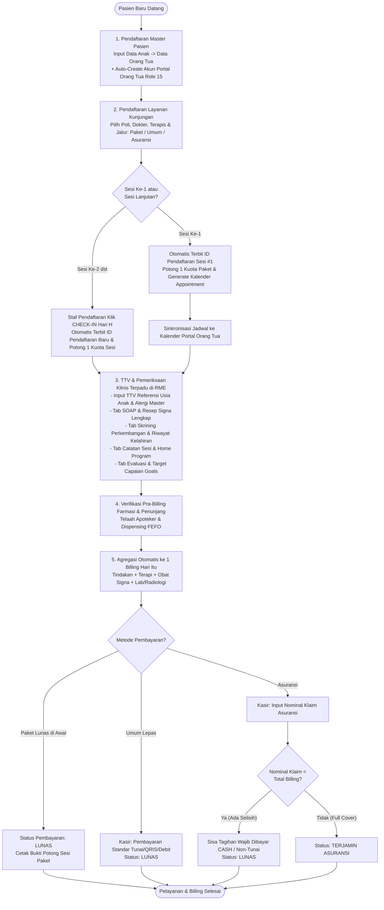

# DOKUMENTASI ARSITEKTUR & ALUR SISTEM SIMRS / E-KLINIK TUMBUH KEMBANG ANAK (SIMRS KLINIKKU) — REVISED & STREAMLINED

Dokumen ini memuat pemetaan alur proses bisnis (*business workflow*) yang telah dirampingkan, penghapusan fitur/endpoint redundan (*take-out list*), arsitektur teknis backend (Laravel API, Database Schema, Controller & Service Layer), pembagian hak akses (*Role-Based Access Control*), dan alur pelayanan satu pintu terpadu.

---

## 1. Daftar Pemangkasan & Konsolidasi (*Take-Out & Merge List*)

Untuk mencegah konflik status data, duplikasi kode, dan birokrasi operasional di lapangan, komponen berikut telah **di-take out atau digabungkan**:

| Komponen / Alur Lama | Keputusan | Arsitektur Baru (Pengganti) |
| :--- | :--- | :--- |
| **Endpoint Pendaftaran & Kedatangan Ganda** (`RegistrasiAnakController@updateKedatangan` & rute `/input-layanan`) | **TAKE OUT & MERGE** | Disatukan penuh ke `PediatricWorkflowController` (`/registrasi` & `/list-pendaftaran-layanan`). |
| **Endpoint Simpan RME Terpisah** (`EmrController@storeSoap`) | **TAKE OUT** | Menggunakan 1 pintu transaksi atomik terpadu di EMR (`POST /api/v1/emr/save` / `completeTherapySession`). |
| **Endpoint Pelunasan Kasir Ganda** (`settleDualTrackInvoice` vs `KasirBillingController@bayar` & rute `/pembayaran-tagihan`) | **TAKE OUT & MERGE** | Disatukan ke satu modul kasir `/kasir-billing` (`KasirBillingController`). Rute `/pembayaran-tagihan` diarahkan ke `/kasir-billing`. |
| **Wajib Buka / Tutup Shift Kasir** (`POST /api/billing/shift/buka` & `tutup`) | **TAKE OUT** | Dihapus agar tidak memblokir transaksi kasir; diganti dengan **Laporan Rekap Pendapatan Harian Otomatis** (`/laporan-pembayaran`). |
| **Multi-Stage Insurance Batch AR** (`submit-claims` & `reconcile`) | **TAKE OUT / SIMPLIFY** | Diganti dengan **Input Nominal Klaim Langsung di Kasir** (`Total Billing - Nominal Klaim = Selisih Cash` dibayar langsung saat itu). |
| **Role Gudang Terpisah (`Role ID 20`)** | **TAKE OUT & MERGE** | Digabungkan ke dalam **Farmasi & Logistik (`Role ID 18`)** agar pengelolaan obat, BHP, dan stok FEFO cukup di 1 peran. |
| **Menu Evaluasi Terpisah** (`/hasil-evaluasi` & `/riwayat-evaluasi`) | **TAKE OUT & MERGE** | Digabung menjadi 1 halaman `/evaluasi-terapi` berbasis *Tab* (`Form Input Evaluasi` & `Riwayat & Monitoring Evaluasi`). |
| **Menu Klinis Terpisah** (`/assesment` & `/catatan-aktivitas-anak`) | **MERGE KE EMR** | Diintegrasikan langsung menjadi tab pada **Pemeriksaan RME Terpadu (`/emr-timeline`)** sehingga dokter dan terapis memiliki 1 Clinical Cockpit terintegrasi. |

---

## 2. Arsitektur Multi-Role & Hak Akses (RBAC — 8 Role Efektif)

Aplikasi menggunakan otentikasi JWT Bearer Token (`auth:api`), Middleware `RequireRole`, serta matriks izin granular (`role_module_permissions`: View, Create, Update, Delete):

| Role ID | Nama Peran | Modul Utama yang Diakses | Tanggung Jawab & Batasan Isolasi Data |
| :---: | :--- | :--- | :--- |
| **13** | **Super Admin** | Semua Modul & Pengaturan Sistem | Konfigurasi klinik, manajemen user/role, audit log SHA-256, matriks RBAC penuh. |
| **14** | **Terapis Klinis** | Dashboard Terapis, Jadwal, Sesi Terapi, RME, Evaluasi | Hanya menangani pasien yang dijadwalkan kepadanya (`WHERE therapist_id = user.id`), isi SOAP & Home Program. |
| **15** | **Orang Tua Pasien**| Portal Orang Tua, **Kalender Sesi Anak**, Home Program, Tagihan | Isolasi data keluarga (`WHERE parent_user_id = user.id`), pantau kalender sesi, konfirmasi hadir, baca Home Program. |
| **16** | **Staf Pendaftaran**| Master Anak & Ortu, Registrasi Layanan, Check-In, Mapping Jadwal | Input master anak & auto-create akun orang tua, daftarkan layanan/paket, Check-In sesi lanjutan, panggil antrian TV. |
| **17** | **Dokter / Psikolog**| Dashboard Dokter, Pemeriksaan RME, **E-Resep (Signa)**, Order Penunjang | Hanya menangani pasiennya (`WHERE doctor_id = user.id`), isi ICD-10/ICD-9-CM, Therapy Order, Obat + Signa. |
| **18** | **Farmasi & Logistik**| Antrian E-Resep (Dispensing), Master Obat/Alat, PR/PO/GRN, Stok FEFO | Telaah resep dokter, dispensing obat metode FEFO, pengelolaan stok barang/alat medis klinik. |
| **19** | **Kasir & Billing** | Kasir POS (`/kasir-billing`), Pelunasan Paket Awal, Klaim Asuransi vs Cash, Laporan | Pelunasan tagihan umum, aktivasi paket di awal, input nominal klaim asuransi + selisih cash, cetak struk thermal. |
| **21** | **Manajemen / Owner**| Dashboard Eksekutif, Pusat Master Data, Laporan Pendapatan & Utilisasi | Pemantauan omzet harian, kinerja terapis, okupansi ruangan, dan audit log rekam medis. |

---

## 3. Diagram Alur Pelayanan End-to-End (Streamlined Flow)

---

## 4. Rincian Alur Bisnis Baku Per Tahap

### 4.1. Pendaftaran Master Anak, Orang Tua & Auto-Create Akun (`Staf Pendaftaran`)
- **Rute Frontend**: `/data-pasien`, `/registrasi`
- **Endpoint Backend**: `POST /api/profile-anak`
- **Logika Bisnis**:
  1. Petugas menginput **Data Anak** (Nama Lengkap, NIK/KIA, Tanggal Lahir dengan auto-kalkulasi usia presisi `Tahun, Bulan, Hari`, Jenis Kelamin, Alergi dari `master_allergies`). Sistem menerbitkan **Nomor Rekam Medis (`RM-YYYYMM-XXXX`)**.
  2. Pada langkah berikutnya, petugas menginput **Data Orang Tua** (Nama Ayah/Ibu, NIK, No. WhatsApp, Email, Username/Password awal). Sistem otomatis membuat akun user dengan `role_id = 15` (`Orang Tua`) yang terikat pada profil anak (`parent_user_id`).

### 4.2. Pendaftaran Layanan, Auto-Appointment & Potong Kuota Saat Check-In (`Staf Pendaftaran`)
- **Rute Frontend**: `/registrasi`, `/list-pendaftaran-layanan`
- **Viewer TV Eksternal**: `viewer-antrian/`
- **Endpoint Backend**:
  - `POST /api/pediatric-workflow/register-session`
  - `POST /api/pediatric-workflow/checkin/{registrasiId}`
  - `POST /api/pediatric-workflow/appointments/{id}/check-in`
- **Logika Bisnis**:
  1. Anak didaftarkan ke **Poli, Dokter, Terapis**, dan **Jalur Pembayaran** (`Paket Terapi`, `Umum`, atau `Asuransi` dengan verifikasi nomor GL).
  2. **Nomor Antrian Cerdas**: Prefix otomatis `TW-xx` (Wicara), `OT-xx` (Okupasi), `FT-xx` (Fisio), `SI-xx` (Sensori), `PK-xx` (Psikologi/Dokter).
  3. **Aturan Sesi #1 vs Sesi Lanjutan**:
     - **Sesi #1:** Otomatis menerbitkan `ID Pendaftaran` hari itu, memotong `1 Kuota Sesi`, dan men-generate jadwal sesi-sesi berikutnya ke dalam `patient_appointments` (tampil sebagai **Kalender** di Portal Orang Tua).
     - **Sesi #2, #3, dst.:** Orang tua cukup datang pada jadwalnya dan petugas menekan **Check-In**. Sistem **otomatis menerbitkan `ID Pendaftaran` baru** untuk tanggal hari tersebut dan **memotong `1 Kuota Sesi`** tepat pada saat tombol Check-In diklik.

### 4.3. Clinical Cockpit: TTV, SOAP, Skrining, Aktivitas & Evaluasi Terpadu (`/emr-timeline`)
- **Rute Frontend**: `/emr-timeline`
- **Endpoint Backend**:
  - `GET /api/v1/master/vital-parameters`, `POST /api/v1/patients/{id}/vitals`
  - `GET /api/v1/master/allergies`, `GET /api/v1/master/soap-templates`
  - `GET /api/pediatric-workflow/icd10`, `GET /api/pediatric-workflow/icd9`
  - `POST /api/v1/emr/save` (Atomic Transaction + SHA-256 Lock)
- **Struktur Workspace Terpadu di RME**:
  - **Tab 1 — Pemeriksaan Klinis (SOAP, E-Resep & Order Penunjang):** Form SOAP terintegrasi TTV usia anak, peringatan konflik alergi obat real-time, order lab/radiologi, dan E-Resep signa lengkap.
  - **Tab 2 — Skrining Tumbuh Kembang & Riwayat Kelahiran (Asesmen Awal):** Anamnesis kehamilan/kelahiran dan 12 parameter skrining perilaku (kejang, milestones, tantrum, flapping, screen time, sensori oral, kontak mata).
  - **Tab 3 — Catatan Sesi Terapi & Home Program:** Log aktivitas intervensi terapis dan tugas rumah (*Home Program*) yang otomatis tampil di Portal Orang Tua.
  - **Tab 4 — Evaluasi Capaian & Goal Tracking:** Target capaian jangka pendek/panjang dengan visualisasi progres capaian %.

### 4.4. Verifikasi Farmasi & Stok Logistik FEFO (`Farmasi & Logistik`)
- **Rute Frontend**: `/dashboard-farmasi`, `/dashboard-penunjang`, `/farmasi-logistik`
- **Endpoint Backend**: `POST /api/pediatric-workflow/verifikasi/resep/{id}/approve`, `POST /api/pediatric-workflow/farmasi/dispense/{id}`, `GET /api/farmasi/kartu-stok/{id}`
- **Logika Bisnis**:
  - Apoteker menelaah E-Resep dokter (cek dosis & interaksi alergi pasien). Setelah di-*approve*, biaya obat otomatis masuk ke billing kasir dan stok dikurangi berdasarkan batch tanggal kedaluwarsa terdekat (**FEFO** — *First Expired, First Out*).

### 4.5. Kasir & Billing POS Satu Pintu (`/kasir-billing`)
- **Rute Frontend**: `/kasir-billing`, `/laporan-pembayaran`
- **Endpoint Backend**: `GET /api/billing/invoices`, `POST /api/billing/invoices/{id}/bayar`, `GET /api/billing/thermal/{id}`
- **Logika Bisnis 3 Jalur Pembayaran (Tanpa Blokir Buka/Tutup Shift)**:
  1. **Paket Terapi (Lunas di Awal):** Pembayaran paket di muka langsung mengubah status invoice paket menjadi **`LUNAS`**. Pada kunjungan sesi-sesi berikutnya, tagihan paket tampil `Rp 0 (Lunas Paket)` kecuali ada tambahan obat/lab di luar paket.
  2. **Pasien Asuransi:** Kasir menginput **Nominal Klaim Asuransi**. Sistem menghitung selisih (`Total Billing - Nominal Klaim`). Jika **Nominal Klaim < Total Billing**, sisa tagihan **wajib dibayar Cash / Non-Tunai** saat itu juga sebelum status berubah menjadi **`LUNAS`**.
  3. **Pasien Umum:** Kasir memproses pembayaran standar (Tunai, QRIS, Transfer, Debit/Kredit) dan mencetak struk thermal 58mm/80mm.
  4. **Amber Alert Kasir:** Kasir diperingatkan jika ada E-Resep atau Order Penunjang kunjungan tersebut yang masih berstatus menunggu verifikasi di Farmasi/Penunjang dan belum masuk bill.

### 4.6. Portal Orang Tua Pasien & Kalender Monitoring (`/dashboard-orang-tua`)
- **Rute Frontend**: `/dashboard-orang-tua`, `/keluhan-anak`
- **Endpoint Backend**: `GET /api/pediatric-workflow/parent/dashboard`, `GET /api/pediatric-workflow/parent/calendar`, `POST /api/pediatric-workflow/parent/session/{id}/confirm`
- **Fitur Utama**:
  - **Kalender Interaktif Jadwal Sesi Anak:** Visualisasi jadwal bulanan/mingguan seluruh sesi terapi anak (Hijau: Selesai, Teal: Terjadwal, Kuning: Reschedule).
  - **Monitoring Kuota & Status Pembayaran:** Menampilkan sisa kuota sesi paket/asuransi dan status pelunasan.
  - **Akses Home Program & Resep:** Membaca instruksi latihan rumah dari terapis dan aturan minum obat (*Signa*) dari dokter.

---

## 5. Matriks Siklus Status Data (*State Machine*)

| Entitas Data | Alur Transisi Status | Pemicu Perubahan (*Trigger*) |
| :--- | :--- | :--- |
| **Registrasi / Sesi** | `terjadwal` $\rightarrow$ `menunggu` $\rightarrow$ `sedang_terapi` $\rightarrow$ `selesai_terapi` | Registrasi $\rightarrow$ Check-In petugas pendaftaran $\rightarrow$ Terapis mulai sesi $\rightarrow$ Simpan RME SHA-256. |
| **Kuota Sesi Paket** | `aktif` $\rightarrow$ `berkurang_saat_checkin` $\rightarrow$ `habis` | Terpotong `-1` tepat ketika petugas Pendaftaran melakukan **Check-In** hari H. |
| **Resep Obat** | `menunggu_verifikasi` $\rightarrow$ `disetujui` $\rightarrow$ `selesai_dispensing` | Order dokter $\rightarrow$ Telaah apoteker $\rightarrow$ Penyerahan obat stok FEFO. |
| **Invoice Paket** | `lunas` *(jika dibayar penuh di awal)* | Sesi lanjutan tidak ditagih biaya sesi lagi kecuali ada tambahan Obat/Lab/Rad. |
| **Invoice Asuransi** | `menunggu_klaim` $\rightarrow$ `lunas_klaim` / `lunas_dengan_excess_cash` | Jika `Nominal Klaim < Total Billing`, wajib pelunasan selisih Cash di Kasir. |
| **Invoice Umum** | `belum_bayar` $\rightarrow$ `lunas` | Menggabungkan seluruh tindakan, terapi, obat (Signa), lab & radiologi hari itu. |

---

## 6. Ringkasan Endpoint Kunci REST API

* **Autentikasi & Akun**: `POST /api/login`, `POST /api/register`, `POST /api/logout`, `GET /api/me`
* **Workflow Klinis Terapi Anak (`/api/pediatric-workflow/`)**:
  - `POST register-session`, `POST checkin/{id}`, `POST appointments/{id}/check-in`
  - `POST therapy-order`, `GET therapy-orders/{id}`
  - `POST session/{id}/start`, `POST session/{id}/complete`
  - `POST e-resep`, `GET verifikasi/antrian-resep`, `POST verifikasi/resep/{id}/approve`, `POST farmasi/dispense/{id}`
  - `POST order-penunjang`, `GET verifikasi/antrian-penunjang`, `POST verifikasi/penunjang/{id}/approve`
  - `POST billing/{id}/settle`, `POST billing/{id}/klaim-asuransi`
  - `GET parent/dashboard`, `GET parent/calendar`, `POST parent/session/{id}/confirm`
* **Kasir & Billing POS Satu Pintu (`/api/billing/`)**:
  - `GET invoices`, `POST invoices/{id}/bayar`, `GET thermal/{id}`
* **Rantai Pasok Farmasi & Logistik (`/api/farmasi/`)**:
  - `GET/POST produk`, `POST batch`, `GET kartu-stok/{id}`, `GET/POST suppliers`, `GET/POST pr`, `GET/POST po`, `GET/POST grn`
* **Pengaturan & Keamanan (`/api/settings/`)**:
  - `GET/POST /`, `GET audit-logs`, `GET/POST rbac-matrix-full`
