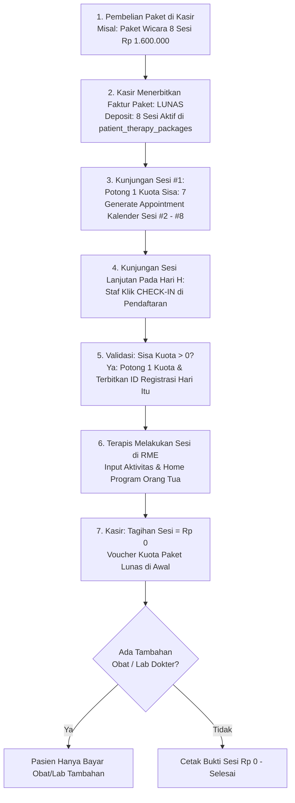
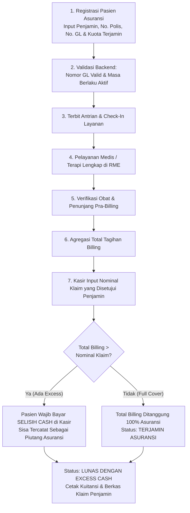

# DOKUMENTASI LENGKAP PROSES BISNIS, VALIDASI & ARSITEKTUR BACKEND
## SIMRS KLINIK TUMBUH KEMBANG & TERAPI ANAK (SIMRS KLINIKKU)

---

## DAFTAR ISI
1. [Pemetaan Proses Bisnis Berdasarkan Jalur Pasien](#1-pemetaan-proses-bisnis-berdasarkan-jalur-pasien)
   - 1.1. [Jalur A: Pasien Umum Lepas (Self-Pay Single Session)](#11-jalur-a-pasien-umum-lepas-self-pay-single-session)
   - 1.2. [Jalur B: Pasien Paket Terapi (Pre-Paid Multi-Session Bundles 4x, 8x, 12x Sesi)](#12-jalur-b-pasien-paket-terapi-pre-paid-multi-session-bundles-4x-8x-12x-sesi)
   - 1.3. [Jalur C: Pasien Asuransi Swasta / Korporasi / BPJS (Guarantor Track)](#13-jalur-c-pasien-asuransi-swasta--korporasi--bpjs-guarantor-track)
   - 1.4. [Alur Kunjungan Pertama vs Sesi Lanjutan](#14-alur-kunjungan-pertama-vs-sesi-lanjutan)
   - 1.5. [Siklus Pra-Billing: E-Resep & Order Penunjang $\rightarrow$ Verifikasi $\rightarrow$ Masuk Tagihan](#15-siklus-pra-billing-e-resep--order-penunjang-rightarrow-verifikasi-rightarrow-masuk-tagihan)
   - 1.6. [Kasir & Billing POS Satu Pintu (Tanpa Blokir Shift)](#16-kasir--billing-pos-satu-pintu-tanpa-blokir-shift)
   - 1.7. [Portal Orang Tua & Kalender Monitoring Sesi](#17-portal-orang-tua--kalender-monitoring-sesi)
   - 1.8. [Rantai Pasok Farmasi & Logistik FEFO](#18-rantai-pasok-farmasi--logistik-fefo)
2. [Matriks Siklus Status Data (State Machine) & Validasi Sistem](#2-matriks-siklus-status-data-state-machine--validasi-sistem)
3. [Inventarisasi Lengkap Berkas Backend & Rincian Fungsinya](#3-inventarisasi-lengkap-berkas-backend--rincian-fungsinya)
   - 3.1. [Daftar 44 Controllers API Beserta Seluruh Method](#31-daftar-44-controllers-api-beserta-seluruh-method)
   - 3.2. [Daftar 73 Model Eloquent Database Beserta Relasi](#32-daftar-73-model-eloquent-database-beserta-relasi)
   - 3.3. [Middlewares & Mekanisme Keamanan Data Scoping](#33-middlewares--mekanisme-keamanan-data-scoping)
   - 3.4. [Services & Layanan AI Lokal](#34-services--layanan-ai-lokal)
   - 3.5. [Struktur Rute REST API Terkonsolidasi](#35-struktur-rute-rest-api-terkonsolidasi)

---

# 1. PEMETAAN PROSES BISNIS BERDASARKAN JALUR PASIEN

Aplikasi SIMRS KlinikKu dirancang untuk melayani klinik tumbuh kembang dan terapi anak secara terpadu melalui tiga jalur penerimaan pasien:

---

### 1.1. Jalur A: Pasien Umum Lepas (*Self-Pay Single Session*)
Jalur ini berlaku untuk pasien yang membayar biaya konsultasi dokter, sesi terapi, obat, atau penunjang secara mandiri per kedatangan (*out-of-pocket pay-per-visit*).

```mermaid
flowchart LR
    RegA[1. Registrasi Kunjungan Umum] --> CheckInA[2. Check-In & No Antrian Poli]
    CheckInA --> MedisA[3. Pemeriksaan RME / Sesi Terapi]
    MedisA --> OrderA[4. Resep / Penunjang Pra-Billing]
    OrderA --> VerifA[5. Verifikasi Farmasi & Penunjang]
    VerifA --> BillA[6. Masuk ke 1 Tagihan Faktur]
    BillA --> KasirA[7. Kasir POS: Pelunasan Tunai/QRIS/Debit]
    KasirA --> StrukA[8. Status LUNAS & Struk 58mm]
```



#### Alur & Validasi Bisnis:
1. **Pendaftaran Pasien:**
   - Didaftarkan dengan parameter `payment_track = 'umum'`.
   - Validasi Nomor Rekam Medis (`profile_anak.no_rm`). Jika pasien baru, sistem menerbitkan format `RM-YYYYMM-XXXX` dan otomatis membuat akun orang tua (`role_id: 15`).
   - Menerbitkan record `registrasi_anak` dengan status `terjadwal`.
2. **Check-In Kedatangan:**
   - Petugas pendaftaran menekan **Check-In** saat pasien tiba di klinik.
   - Validasi: Status registrasi berubah dari `terjadwal` $\rightarrow$ `menunggu`.
   - Sistem menerbitkan **Nomor Antrian Cerdas** sesuai poli/layanan:
     - `TW-xx`: Terapi Wicara
     - `OT-xx`: Okupasi Terapi
     - `FT-xx`: Fisioterapi Pediatrik
     - `SI-xx`: Sensori Integrasi
     - `PK-xx`: Dokter Spesialis Anak / Psikolog
3. **Pemeriksaan Klinis di RME Terpadu (`/emr-timeline`):**
   - Dokter/Terapis menginput tanda-tanda vital (TTV) dan antropometri anak (TD, HR, RR, Temp, SpO2, BB, TB, Lingkar Kepala). Sistem membandingkan nilai input dengan rentang acuan usia anak secara dinamis.
   - Dokter mengisi SOAP, ICD-10, ICD-9-CM, Therapy Order, serta E-Resep / Order Penunjang.
   - Status awal E-Resep & Penunjang adalah `menunggu_verifikasi` (**Pra-Billing**). Biaya **belum masuk** ke tagihan kasir.
4. **Verifikasi Petugas:**
   - Apoteker di `/dashboard-farmasi` menelaah resep (aspek administratif, farmasetik, klinis) dan mengecek stok batch terdekat (FEFO).
   - Petugas Penunjang di `/dashboard-penunjang` menginput kesimpulan hasil eksaminasi laboratorium/radiologi.
   - Saat tombol **"Verifikasi & Masukkan ke Bill"** ditekan, item secara atomik ditambahkan ke `invoice_items` dan tagihan kasir otomatis bertambah.
5. **Pelunasan Kasir POS Satu Pintu (`/kasir-billing`):**
   - Tagihan menggabungkan seluruh komponen: Jasa Dokter/Terapis + Obat Resep + Lab/Rad.
   - Kasir memilih metode pembayaran (Tunai, QRIS Statis/Dinamis, Transfer Bank, Kartu Debit EDC).
   - Invoice berubah menjadi `lunas` dan kasir mencetak kuitansi struk thermal 58mm/80mm.

---

### 1.2. Jalur B: Pasien Paket Terapi (*Pre-Paid Multi-Session Bundles 4x, 8x, 12x Sesi*)
Jalur ini dirancang untuk program terapi berkelanjutan (Speech Therapy, OT, Sensori Integrasi) yang membutuhkan 4 s.d. 12 pertemuan terjadwal dengan pembayaran di muka (*pre-paid upfront*).



#### Alur & Validasi Bisnis:
1. **Pembelian Paket & Aktivasi Kuota:**
   - Orang tua membeli paket terapi dari katalog `therapy_packages`.
   - Kasir menerbitkan invoice pembelian paket dan memproses pelunasan penuh. Status invoice paket: `LUNAS`.
   - Sistem mencatat record deposit pada `patient_therapy_packages`:
     - `jumlah_sesi_total = 8`
     - `sisa_sesi = 8`
     - `status = 'aktif'`
     - `tanggal_kedaluwarsa = now() + masa_berlaku_hari`
2. **Registrasi Sesi #1 & Auto-Appointment Kalender:**
   - Kunjungan sesi #1 diterbitkan dengan `payment_track = 'umum_package'`.
   - Kuota sesi langsung terpotong `-1` (Sisa: 7).
   - Sistem men-generate jadwal sesi-sesi lanjutan (#2 s.d. #8) ke dalam tabel `patient_appointments` sesuai slot rutin mingguan (misal: setiap Selasa & Kamis jam 10:00).
   - Seluruh jadwal sinkron ke **Kalender Interaktif** Portal Orang Tua (`/dashboard-orang-tua`).
3. **Mekanisme Check-In Sesi Lanjutan (#2 dst.):**
   - Pada hari H, anak hadir ke klinik. Staf pendaftaran menekan **Check-In**.
   - **Validasi Kritis Sistem (`checkInAppointment`):**
     1. Sistem memeriksa `patient_therapy_packages.sisa_sesi > 0`. Jika `0`, sistem memblokir check-in: *"Kuota sesi paket telah habis, silakan beli paket baru atau daftar umum."*
     2. Sistem memeriksa tanggal apakah `now() <= tanggal_kedaluwarsa`. Jika telah lewat, pendaftaran ditolak.
     3. Jika valid: Kuota terpotong `-1`, sistem menerbitkan `registrasi_anak` baru untuk hari itu, dan membuat invoice bernilai **Rp 0 (Voucher Sesi Paket)**.
4. **Pelayanan Terapi & Home Program:**
   - Terapis menginput durasi intervensi, respons anak, dan instruksi latihan rumah (*Home Program*).
   - Saat sesi disimpan, tanda tangan digital SHA-256 mengunci sesi, dan Home Program langsung tampil di Portal Orang Tua.
5. **Kasir POS Tagihan Paket:**
   - Biaya sesi terapi adalah **Rp 0** karena sudah lunas di awal.
   - Jika ada resep obat atau penunjang lab di luar paket, kasir hanya menagihkan biaya tambahan tersebut.
   - Kasir mencetak **Struk Bukti Potong Sesi Paket & Sisa Kuota Sesi**.

---

### 1.3. Jalur C: Pasien Asuransi Swasta / Korporasi / BPJS (*Guarantor Track*)
Jalur ini berlaku untuk pasien yang biayanya dijamin oleh pihak ketiga (Asuransi Swasta rekanan seperti AdMedika, Prudential, Mandiri Inhealth, atau BPJS) berdasarkan Surat Jaminan (*Guarantee Letter* / GL).



#### Alur & Validasi Bisnis:
1. **Verifikasi Polis & Surat Jaminan (GL):**
   - Staf pendaftaran memilih institusi penjamin dari tabel `guarantors`.
   - Menginput parameter pada `patient_insurances`:
     - `no_kartu_asuransi`, `no_surat_jaminan` (GL).
     - `kuota_sesi_dijamin` (misal: dijamin maksimal 10x sesi).
     - `plafon_biaya` (plafon nominal yang ditanggung).
     - `tanggal_kadaluarsa_gl`.
   - **Validasi Sistem:**
     - Menolak pendaftaran jika tanggal hari ini telah melewati masa berlaku GL.
     - Menolak jika kuota sesi penjaminan telah habis (`sesi_terpakai >= kuota_sesi_dijamin`).
2. **Pemeriksaan Klinis di RME:**
   - Dokter/Terapis memberikan intervensi sesuai diagnosa yang di-cover asuransi.
3. **Kalkulasi Selisih Kasir (Co-Payment / Excess Cash):**
   - Kasir membuka `/kasir-billing` dan memilih tab **Asuransi Klaim**.
   - Sistem menghitung total faktur dari seluruh tindakan, terapi, obat, dan penunjang:
     $$\text{Total Billing} = \sum \text{Subtotal Item}$$
   - Kasir menginput **Nominal yang Disetujui Penjamin** (berdasarkan konfirmasi portal/telepon asuransi).
   - **Kalkulasi Selisih Kasir:**
     $$\text{Selisih (Excess Cash Wajib Bayar)} = \max(0, \text{Total Billing} - \text{Nominal Klaim})$$
   - **Dua Skenario Pelunasan:**
     1. **Full Cover ($\text{Selisih} = 0$):** Pasien tidak membayar biaya apapun di kasir. Total nilai tagihan dipindahkan menjadi **Piutang Penjamin (AR Asuransi)** pada tabel `insurance_claims`. Status tagihan: `terjamin_asuransi`.
     2. **Ada Selisih ($\text{Selisih} > 0$):** Orang tua **wajib melunasi selisih tunai/non-tunai** tersebut saat itu juga di kasir. Sistem mencatat pembayaran excess pada `pembayaran_transaksi` dan sisa klaim menjadi piutang penjamin. Status invoice menjadi `lunas`.

---

### 1.4. Alur Kunjungan Pertama vs Sesi Lanjutan

Klinik membedakan alur kunjungan pertama dengan kunjungan sesi rutin:

1. **Kunjungan Pertama (Konsultasi Awal & Asesmen):**
   - Pasien diarahkan ke **Dokter Spesialis Anak (Sp.A) / Sp.KFR / Psikolog Klinis**.
   - Dokter melakukan skrining perkembangan, anamnesis riwayat kelahiran, penegakan diagnosa ICD-10, dan menerbitkan **Therapy Order (Rekomendasi Terapi)** yang memuat: jenis layanan terapi, frekuensi mingguan, total target sesi, dan target capaian jangka pendek/panjang.
2. **Kunjungan Sesi Lanjutan (Pelaksanaan Terapi Rutin):**
   - Pasien tidak perlu ke dokter lagi. Orang tua langsung melakukan **Check-In** di bagian pendaftaran sesuai jadwal.
   - Pasien masuk ke ruang terapi bersama **Terapis Pelaksana**.
   - Terapis mengacu pada Therapy Order yang telah dibuat oleh dokter konsultan.

---

### 1.5. Siklus Pra-Billing: E-Resep & Order Penunjang $\rightarrow$ Verifikasi $\rightarrow$ Masuk Tagihan

Order dokter **tidak langsung menjadi tagihan kasir**, melainkan melewati tahap validasi pra-billing:

```
[DOKTER DI EMR TIMELINE]
  │── Menerbitkan E-Resep Obat ─────────────> Status: 'menunggu_verifikasi'
  └── Mengajukan Order Lab / Radiologi ─────> Status: 'menunggu_verifikasi'
                                                      │ (BELUM MASUK INVOICE KASIR)
       ┌──────────────────────────────────────────────┴──────────────────────────────┐
       ▼                                                                             ▼
[WORKSPACE FARMASI / APOTEKER]                                       [WORKSPACE PETUGAS PENUNJANG]
Rute: /dashboard-farmasi                                             Rute: /dashboard-penunjang
• Telaah 3 Aspek Kemenkes                                            • Pengambilan sampel / Rontgen
• Verifikasi dosis mg/kgBB & alergi                                  • Input kesimpulan & hasil tes
• Cek stok batch terdekat (FEFO)                                     • Klik: "Verifikasi & Masuk Bill"
• Klik: "Verifikasi & Masuk Bill"                                                    │
       │                                                                             │
       └──────────────────────────────────────┬──────────────────────────────────────┘
                                              ▼
                    [SISTEM MENAMBAHKAN ITEM KE INVOICE SECARA ATOMIK]
                    • Tabel invoice_items bertambah record baru
                    • Total tagihan faktur kasir terupdate otomatis
                    • Kasir & EMR melihat status: 'Diverifikasi'
```

---

### 1.6. Kasir & Billing POS Satu Pintu (Tanpa Blokir Shift)
- **Modul Tunggal:** Seluruh penagihan dilakukan melalui [`/kasir-billing`](file:///d:/Project/e-klinik-system-dev/frontend/src/views/Kasir-Billing.vue).
- **Tanpa Blokir Shift:** Kasir dapat langsung melayani transaksi tanpa harus membuka atau menutup shift terlebih dahulu. Rekap harian disediakan otomatis via [`/laporan-pembayaran`](file:///d:/Project/e-klinik-system-dev/frontend/src/views/LaporanPembayaran.vue).
- **Amber Alert Kasir:** Jika pasien memiliki E-Resep atau Order Penunjang yang masih berstatus `menunggu_verifikasi`, kasir mendapatkan notifikasi peringatan berwarna amber: *"Terdapat order dokter yang belum diverifikasi oleh Farmasi/Penunjang dan belum masuk ke tagihan faktur ini."*
- **Struk Thermal:** Format cetak standar POS 58mm/80mm memuat nomor invoice, identitas anak, nomor RM, jalur bayar, rincian biaya, dan sisa kuota paket/asuransi.

---

### 1.7. Portal Orang Tua & Kalender Monitoring Sesi
- **Rute:** [`/dashboard-orang-tua`](file:///d:/Project/e-klinik-system-dev/frontend/src/views/DashboardOrangTua.vue)
- **Akses & Keamanan:** Akun dibuat otomatis saat pendaftaran anak (`role_id: 15`). Menggunakan row-level data scoping (`WHERE id_orang_tua = auth()->id()`).
- **Fitur Utama:**
  1. *Kalender Interaktif:* Visualisasi seluruh sesi terapi anak (Hijau: Selesai, Teal: Terjadwal, Kuning: Reschedule).
  2. *Konfirmasi Kehadiran:* Orang tua dapat mengonfirmasi kehadiran sesi H-1.
  3. *Home Program:* Membaca instruksi latihan mandiri di rumah yang ditulis terapis.
  4. *Monitoring Kuota & Pembayaran:* Memantau sisa sesi paket atau batas penjaminan asuransi.

---

### 1.8. Rantai Pasok Farmasi & Logistik FEFO
Dikelola oleh **Farmasi & Logistik (`Role ID 18`)** melalui tahapan:
1. **Purchase Requisition (PR):** Pengajuan kebutuhan stok obat & BHP.
2. **Purchase Order (PO):** Penerbitan surat pesanan resmi ke distributor farmasi rekanan.
3. **Goods Received Note (GRN):** Penerimaan fisik barang di gudang dengan pencatatan nomor batch pabrikan dan tanggal kedaluwarsa (*Expiry Date*).
4. **Kartu Stok (Ledger):** Setiap penerimaan dan pengeluaran obat tercatat di buku besar `kartu_stok` secara real-time.
5. **Dispensing FEFO (*First Expired, First Out*):** Sistem memprioritaskan pengurangan stok dari batch dengan tanggal kedaluwarsa terdekat.

---

# 2. MATRIKS SIKLUS STATUS DATA (STATE MACHINE) & VALIDASI SISTEM

| Entitas Data | State Awal | State Transisi | State Akhir | Syarat & Validasi Backend |
| :--- | :--- | :--- | :--- | :--- |
| **Registrasi Anak** (`registrasi_anak`) | `terjadwal` | `menunggu` $\rightarrow$ `sedang_terapi` | `selesai_terapi` / `batal` | • Pindah ke `menunggu` hanya via tombol Check-In.<br>• Pindah ke `sedang_terapi` saat terapis membuka sesi.<br>• Pindah ke `selesai_terapi` saat RME disimpan dengan hash SHA-256. |
| **Kuota Sesi Paket** (`patient_therapy_packages`) | `aktif` (`sisa_sesi = N`) | `berkurang_saat_checkin` (`sisa_sesi - 1`) | `habis` (`sisa_sesi = 0`) | • Terpotong tepat pada saat klik **Check-In** hari H.<br>• Ditolak jika `sisa_sesi <= 0` atau tanggal hari ini lewat masa berlaku. |
| **E-Resep Dokter** (`e_resep`) | `menunggu_verifikasi` | `disetujui` / `ditolak` | `selesai_dispensing` | • Ditolak jika mengandung obat yang bertentangan dengan riwayat alergi pasien.<br>• Masuk ke bill invoice registrasi hanya setelah apoteker menekan approve. |
| **Order Penunjang** (`order_penunjang`) | `menunggu_verifikasi` | `sedang_proses` | `selesai` / `batal` | • Masuk ke invoice hanya setelah hasil laboratorium/radiologi diisi oleh petugas penunjang. |
| **Faktur Tagihan** (`invoices`) | `belum_bayar` | `bayar_sebagian` | `lunas` / `terjamin_asuransi` | • Status `lunas` jika dibayar penuh.<br>• Untuk voucher paket lunas di awal: langsung terbit status `lunas` (Rp 0).<br>• Untuk asuransi: jika ada excess cash, wajib lunas selisih sebelum ditutup. |
| **Piutang Klaim Asuransi** (`insurance_claims`) | `draft` | `diajukan` | `lunas` / `reconciled` | • Dicatat saat kasir memproses tagihan asuransi.<br>• Selesai saat rekonsiliasi transfer bank dari pihak asuransi diverifikasi. |

---

# 3. INVENTARISASI LENGKAP BERKAS BACKEND & RINCIAN FUNGSINYA

---

### 3.1. Daftar 44 Controllers API Beserta Seluruh Method (`backend/app/Http/Controllers/Api/`)

| No | Nama Controller | Rute Utama | Method Publik | Tanggung Jawab Operasional |
| :---: | :--- | :--- | :--- | :--- |
| 1 | **`PediatricWorkflowController.php`** | `/api/pediatric-workflow/*` | `registerChildSession`, `checkInSession`, `getAppointments`, `checkInAppointment`, `storeTherapyOrder`, `getTherapyOrders`, `startTherapySession`, `completeTherapySession`, `storeEResep`, `getEResepByRegistrasi`, `getRegistrationOrdersSummary`, `getAntrianResepFarmasi`, `dispenseResep`, `getVerifikasiOverviewStats`, `getAntrianVerifikasiResep`, `verifikasiResepApprove`, `verifikasiResepReject`, `storeOrderPenunjang`, `getOrderPenunjangByRegistrasi`, `getAntrianVerifikasiPenunjang`, `verifikasiPenunjangApprove`, `verifikasiPenunjangReject`, `settleDualTrackInvoice`, `settleAsuransiKlaim`, `getInsuranceClaims`, `submitClaimBatch`, `reconcileInsuranceClaim`, `getParentDashboard`, `getParentCalendar`, `confirmAttendance`, `getGuarantors`, `storeGuarantor`, `deleteGuarantor`, `getTherapyPackages`, `storeTherapyPackage`, `deleteTherapyPackage`, `getIcd10All`, `storeIcd10`, `deleteIcd10`, `getIcd9All`, `storeIcd9`, `deleteIcd9`, `getMasterOverviewStats` | **Pusat Logika Bisnis Utama (Core Engine)** yang mengendalikan seluruh siklus klinis anak: pendaftaran dual-track, potong kuota paket saat check-in, E-Resep & penunjang pra-billing, verifikasi dashboard apoteker/lab, perhitungan klaim asuransi vs excess kasir, hingga kalender sesi portal orang tua. |
| 2 | **`KasirBillingController.php`** | `/api/billing/*` | `index`, `show`, `store`, `bayar`, `statusShift`, `bukaShift`, `tutupShift`, `cetakThermal`, `laporanHarian` | Mengelola modul kasir POS satu pintu: melihat daftar faktur aktif, memproses pelunasan (tunai/QRIS/transfer/EDC), menghitung kembalian, rekap laporan penerimaan harian, dan menghasilkan format struk thermal 58mm/80mm. |
| 3 | **`EmrController.php`** | `/api/emr/*` | `timeline`, `storeSoap`, `updateSoap`, `addAddendum`, `uploadAttachment`, `getAuditLogs`, `goals`, `storeGoal`, `updateGoalProgress` | Mengelola data Rekam Medis Elektronik (RME): timeline kronologis kunjungan anak, pencatatan SOAP, penguncian integritas SHA-256, addendum catatan medis terkoreksi, lampiran berkas penunjang, dan pelacakan capaian target terapi (*Goal Tracking*). |
| 4 | **`ClinicalMasterController.php`** | `/api/v1/master/*` | `vitalParameters`, `vitalReferenceRanges`, `allergies`, `soapTemplates`, `procedures`, `ancillaryTests`, `medications`, `units`, `signas`, `intakeTimes`, `getPatientVitals`, `storePatientVital`, `getPatientAllergies`, `storePatientAllergies`, `saveEmrAtomic` | Menyediakan seluruh data master klinis baku (referensi vital signs pediatrik berdasarkan usia, master alergi, template SOAP, master obat, satuan, signa waktu minum) dan menangani penyimpanan transaksi klinis atomik RME. |
| 5 | **`FarmasiLogistikController.php`** | `/api/farmasi/*` | `produkIndex`, `produkStore`, `produkUpdate`, `batchStore`, `kartuStok`, `supplierIndex`, `supplierStore`, `prIndex`, `prStore`, `poIndex`, `poStore`, `grnIndex`, `grnStore` | Mengendalikan rantai pasok farmasi dan logistik klinik: katalog obat & BHP, penerimaan barang (GRN), pencatatan nomor batch & expired date, kartu stok mutasi masuk-keluar, serta rekomendasi dispensing berbasis FEFO. |
| 6 | **`ProfileAnakController.php`** | `/api/profile-anak/*`, `/api/pendaftaran/anak` | `index`, `store`, `show`, `update`, `destroy`, `anakSaya` | Mengelola data master pasien anak: Nomor Rekam Medis (auto-generate), NIK, tanggal lahir & usia presisi (tahun, bulan, hari), jenis kelamin, agama, riwayat alergi, serta isolasi data anak kandung untuk orang tua yang login. |
| 7 | **`RegistrasiAnakController.php`** | `/api/registrasi-anak/*` | `index`, `store`, `show`, `update`, `destroy`, `terapisByTanggal`, `updateKedatangan`, `panggil`, `kirimEmailJadwal` | Mengelola pendaftaran antrian rawat jalan dan kedatangan pasien di klinik, pencatatan nomor registrasi, relasi poli dan ruangan terapi, serta pemanggilan antrian TV. |
| 8 | **`AuthController.php`** | `/api/auth/*`, `/api/login`, `/api/logout` | `login`, `register`, `logout`, `refresh`, `me`, `checkUsername`, `updatePassword`, `resetPasswordByOtp` | Otentikasi pengguna berbasis JSON Web Token (JWT), manajemen sesi login, pergantian kata sandi, dan verifikasi akun. |
| 9 | **`ClinicSettingsController.php`** | `/api/settings/*` | `getSettings`, `updateSettings`, `auditLogs`, `rbacMatrix`, `getFullRbacMatrix`, `updateRoleModuleMatrix` | Pengaturan konfigurasi umum klinik, pemantauan log aktivitas keamanan (*audit logs*), serta matriks hak akses modular (*RBAC Matrix*: View, Create, Update, Delete). |
| 10 | **`MappingJadwalController.php`** | `/api/mapping-jadwal/*` | `index`, `store`, `destroy` | Mengatur pemetaan slot jadwal praktik dokter, terapis, dan ketersediaan ruangan klinik. |
| 11 | **`SuratDokumenController.php`** | `/api/surat/*`, `/api/public/surat/*` | `getTemplates`, `storeTemplate`, `getSuratKeluar`, `createSuratKeluar`, `cetakPdf`, `verifyQrPublic` | Penerbitan dokumen klinis resmi (Surat Keterangan Terapi, Surat Rujukan, Informed Consent) dilengkapi tanda tangan digital QR Code yang dapat diverifikasi publik tanpa login. |
| 12 | **`DashboardAdminController.php`** | `/api/dashboard-admin/*` | `index`, `statistikKunjungan`, `omzetRingkasan` | Menyediakan data metrik ringkasan untuk Super Admin dan Manajemen: jumlah pasien aktif, total kunjungan hari ini, okupansi terapis, dan pendapatan. |
| 13 | **`DashboardTerapisController.php`** | `/api/dashboard-terapis/*` | `index`, `pasienSaya`, `jadwalHariIni` | Menyediakan data khusus terapis yang login: daftar pasien antrian hari ini yang dijadwalkan kepadanya, jadwal sesi, dan status penyelesaian aktivitas. |
| 14 | **`CatatanAktivitasAnakController.php`** | `/api/catatan-aktivitas-anak/*` | `index`, `store`, `show`, `update`, `destroy`, `byRegistrasi` | Pencatatan detail aktivitas terapi per sesi, durasi, respon klinis anak, dan tugas rumah (*Home Program*) yang terhubung ke orang tua. |
| 15 | **`EvaluasiTerapiController.php`** | `/api/evaluasi-terapi/*` | `index`, `store`, `show`, `update`, `byRegistrasi` | Pencatatan evaluasi berkala capaian multi-sesi: analisis perilaku, kondisi awal vs saat ini, dan rekomendasi program terapi lanjutan. |
| 16 | **`HasilEvaluasiAnakController.php`** | `/api/hasil-evaluasi/*` | `index`, `show`, `cetak` | Menampilkan rekapitulasi hasil evaluasi terapi anak yang telah diselesaikan untuk pelaporan klinis dan orang tua. |
| 17 | **`RiwayatEvaluasiController.php`** | `/api/riwayat-evaluasi/*` | `index`, `show` | Menyediakan riwayat evaluasi historis seluruh pasien untuk keperluan audit dan monitoring perkembangan jangka panjang. |
| 18 | **`JadwalMasterController.php`** | `/api/jadwal-master/*` | `index`, `store`, `update`, `destroy` | Master slot jam pelayanan klinik (hari, jam mulai, jam selesai, kuota maksimal anak per slot). |
| 19 | **`JadwalUserController.php`** | `/api/jadwal-user/*` | `index`, `store`, `update`, `destroy` | Penetapan jadwal kerja terapis dan dokter pada slot master yang tersedia. |
| 20 | **`KategoriLayananController.php`** | `/api/kategori-layanan/*` | `index`, `store`, `update`, `destroy` | Master kategori poli pelayanan (Terapi Wicara, Okupasi, Fisioterapi, Sensori Integrasi, Psikologi, Konsultasi Dokter). |
| 21 | **`LayananController.php`** | `/api/layanan/*` | `index`, `store`, `update`, `destroy` | Master tarif tindakan dan paket layanan klinis (harga weekday vs weekend). |
| 22 | **`RuanganController.php`** | `/api/ruangan/*` | `index`, `store`, `update`, `destroy` | Master data ruangan terapi dan poli konsultasi klinik. |
| 23 | **`TerapisToRuanganController.php`** | `/api/terapis-ruangan/*` | `index`, `store`, `destroy` | Pemetaan penugasan terapis ke ruangan tertentu pada tanggal operasional klinik. |
| 24 | **`MasterUserProfileController.php`** | `/api/master-user-profile/*` | `index`, `store`, `update`, `destroy` | Pengelolaan profil pengguna lengkap: staf, dokter, terapis, kasir, farmasi, dan manajemen. |
| 25 | **`UserLoginController.php`** | `/api/user-login/*` | `index`, `store`, `update`, `destroy` | Pengelolaan kredensial akun login pengguna, username, password hash, dan status aktif/non-aktif. |
| 26 | **`RoleController.php`** | `/api/role/*` | `index`, `store`, `update`, `destroy` | Master peran sistem (Super Admin, Dokter, Terapis, Farmasi, Kasir, Pendaftaran, Orang Tua, Manajemen). |
| 27 | **`KeluhanAnakController.php`** | `/api/keluhan-anak/*` | `index`, `store`, `show`, `update` | Pengaduan / keluhan dari orang tua terkait layanan klinik dan tindak lanjut dari manajemen klinik. |
| 28 | **`LaporanPembayaranController.php`** | `/api/laporan-pembayaran/*` | `index`, `exportExcel`, `rekapHarian` | Laporan penerimaan kas, omzet per metode bayar, per jenis layanan, dan rekonsiliasi kasir harian. |
| 29 | **`LaporanKeluhanController.php`** | `/api/laporan-keluhan/*` | `index`, `rekapStatistik` | Laporan berkala penanganan keluhan orang tua pasien untuk evaluasi mutu pelayanan (*quality control*). |
| 30 | **`LaporanHistoryPromosiController.php`**| `/api/laporan-promosi/*` | `index` | Laporan efektivitas penggunaan voucher diskon dan promosi paket klinik. |
| 31 | **`PromosiController.php`** | `/api/promosi/*` | `index`, `store`, `update`, `destroy`, `aktif` | Pengelolaan voucher diskon, potongan harga sesi terapi, dan masa berlaku promosi klinik. |
| 32 | **`OtpEmailController.php`** | `/api/otp-email/*` | `send`, `verify`, `sendReset`, `verifyReset` | Pengiriman kode OTP via email untuk verifikasi akun orang tua dan pemulihan kata sandi. |
| 33 | **`PelayananTerapiAnakController.php`** | `/api/pelayanan-terapi-anak/*`| `index`, `store`, `updateStatus`, `updateTerapis`, `ajukanReschedule`, `approveReschedule`, `rejectReschedule` | Detail relasi sesi terapi anak, pengaturan pergantian terapis pengganti, dan pengajuan reschedule sesi. |
| 34 | **`PembayaranRegistrasiController.php`** | `/api/pembayaran-registrasi/*`| `index`, `store`, `byRegistrasi`, `riwayatPembayaranAnak`, `uploadBukti`, `verifikasiAdmin` | Dukungan transaksi pembayaran pendaftaran legacy dan upload bukti transfer rekening. |
| 35 | **`AIController.php`** | `/api/ai-command/*` | `executeCommand`, `nlQuery` | Menghubungkan permintaan pencarian berbasis bahasa alami (*Natural Language Processing*) pengguna ke layanan AI lokal. |
| 36 | **`InvoiceController.php`** | `/api/invoices/*` | `index`, `show` | Endpoint lookup data invoice dan item penagihan pasien. |
| 37 | **`JenisKelaminController.php`** | `/api/jenis-kelamin/*` | `index` | Master data jenis kelamin pasien (Laki-laki / Perempuan). |
| 38 | **`AgamaController.php`** | `/api/agama/*` | `index` | Master data referensi agama pasien dan staf. |
| 39 | **`JenisPegawaiController.php`** | `/api/jenis-pegawai/*` | `index`, `store`, `update` | Master klasifikasi profesi pegawai klinik (Medis, Keperawatan, Terapis, Administrasi). |
| 40 | **`JenisUserController.php`** | `/api/jenis-user/*` | `index`, `store`, `update` | Klasifikasi kelompok user internal vs eksternal. |
| 41 | **`PegawaiController.php`** | `/api/pegawai/*` | `index`, `store`, `update`, `destroy` | Biodata kepegawaian staf klinik, nomor STR/SIP tenaga medis, dan tanggal mulai bekerja. |
| 42 | **`UserProfileController.php`** | `/api/user-profile/*` | `index`, `store`, `show`, `update` | Informasi data diri pengguna yang sedang login. |
| 43 | **`LandingController.php`** | `/api/landing/*` | `index`, `infoKlinik`, `layananUnggulan` | Menyediakan konten informasi publik klinik, jadwal dokter, dan layanan unggulan untuk halaman depan (*Landing Page*). |
| 44 | **`Assesment1Controller.php`** | `/api/assesment/*` | `index`, `store`, `show`, `update` | Form skrining klinis tahap 1 dan anamnesis tumbuh kembang anak. |

---

### 3.2. Daftar 73 Model Eloquent Database Beserta Relasi (`backend/app/Models/`)

| No | Model | Tabel Database | Relasi Utama (*Relationships*) | Fungsi & Atribut Kunci |
| :---: | :--- | :--- | :--- | :--- |
| 1 | **`RegistrasiAnak.php`** | `registrasi_anak` | `belongsTo(ProfileAnak)`, `belongsTo(UserProfile, 'terapis_id')`, `belongsTo(Ruangan)`, `hasMany(Invoice)`, `hasMany(PelayananTerapiAnak)`, `hasOne(TherapyOrder)`, `hasMany(EResep)`, `hasMany(OrderPenunjang)`, `hasMany(PatientAppointment)`, `hasManyThrough(PembayaranTransaksi, Invoice)` | Model sentral kunjungan: `no_regis`, `no_antrian`, `status`, tanggal registrasi, dan kedatangan. |
| 2 | **`ProfileAnak.php`** | `profile_anak` | `belongsTo(UserProfile, 'id_orang_tua')`, `belongsTo(JenisKelamin)`, `belongsTo(Agama)`, `hasMany(RegistrasiAnak)`, `hasMany(PatientVitalRecord)`, `hasMany(PatientAllergy)`, `hasMany(PaketTerapiPasien)`, `hasMany(PatientInsurance)` | Master anak: `no_rm`, `nama_anak`, `nik`, `tanggal_lahir`, `anak_ke`, riwayat kelahiran, catatan alergi. |
| 3 | **`Invoice.php`** | `invoices` | `belongsTo(RegistrasiAnak)`, `belongsTo(ProfileAnak)`, `belongsTo(Guarantor)`, `hasMany(InvoiceItem)`, `hasMany(PembayaranTransaksi)`, `hasOne(InsuranceClaim)` | Faktur kasir: `nomor_invoice`, `total_tagihan`, `total_terbayar`, `sisa_tagihan`, `status`, `payment_track`. |
| 4 | **`InvoiceItem.php`** | `invoice_items` | `belongsTo(Invoice)` | Rincian faktur: `tipe_item` (`layanan`, `obat_resep`, `order_penunjang`), `deskripsi`, `qty`, `harga_satuan`, `subtotal`. |
| 5 | **`EResep.php`** | `e_resep` | `belongsTo(RegistrasiAnak)`, `belongsTo(ProfileAnak)`, `belongsTo(UserProfile, 'dokter_id')`, `belongsTo(UserProfile, 'verified_by')`, `hasMany(EResepItem)` | Preskripsi obat dokter: `nomor_resep`, `status`, `catatan_telaah`, `verified_at`, `verified_by`. |
| 6 | **`EResepItem.php`** | `e_resep_items` | `belongsTo(EResep)`, `belongsTo(MasterProduk)` | Obat resep: `nama_obat`, `jumlah`, `satuan`, `signa`, `waktu_minum`, `catatan_racikan`, `harga_satuan`, `subtotal`. |
| 7 | **`OrderPenunjang.php`** | `order_penunjang` | `belongsTo(RegistrasiAnak)`, `belongsTo(ProfileAnak)`, `belongsTo(UserProfile, 'dokter_id')`, `belongsTo(UserProfile, 'verified_by')` | Order diagnostik: `nomor_order`, `jenis_order`, `nama_tindakan`, `tarif`, `hasil_pemeriksaan`, `status`. |
| 8 | **`PembayaranTransaksi.php`** | `pembayaran_transaksi` | `belongsTo(Invoice)`, `belongsTo(UserProfile, 'kasir_id')` | Transaksi kasir: `nomor_transaksi`, `metode_bayar`, `jumlah_bayar`, `kembalian`, `nomor_referensi`, `bukti_bayar`. |
| 9 | **`PaketTerapiPasien.php`** | `patient_therapy_packages` | `belongsTo(ProfileAnak)`, `belongsTo(TherapyPackage)`, `belongsTo(Invoice)` | Kuota paket anak: `jumlah_sesi_total`, `sisa_sesi`, `status`, `tanggal_kedaluwarsa`. |
| 10 | **`PatientAppointment.php`**| `patient_appointments` | `belongsTo(ProfileAnak)`, `belongsTo(UserProfile, 'terapis_id')`, `belongsTo(Ruangan)`, `belongsTo(RegistrasiAnak)` | Janji temu kalender: `tanggal_appointment`, `jam_mulai`, `jam_selesai`, `sesi_ke`, `status`. |
| 11 | **`PatientInsurance.php`** | `patient_insurances` | `belongsTo(ProfileAnak)`, `belongsTo(Guarantor)` | Jaminan asuransi: `no_kartu_asuransi`, `no_surat_jaminan`, `kuota_sesi_dijamin`, `sesi_terpakai`, `plafon_biaya`. |
| 12 | **`Guarantor.php`** | `guarantors` | `hasMany(PatientInsurance)`, `hasMany(Invoice)` | Master instansi penjamin: `kode_penjamin`, `nama_penjamin`, `jenis`, `kontak_person`. |
| 13 | **`InsuranceClaim.php`** | `insurance_claims` | `belongsTo(Invoice)`, `belongsTo(Guarantor)` | Piutang klaim penjamin (AR): `nomor_pengajuan`, `nominal_diajukan`, `nominal_disetujui`, `status`. |
| 14 | **`TherapyOrder.php`** | `therapy_orders` | `belongsTo(RegistrasiAnak)`, `belongsTo(ProfileAnak)`, `belongsTo(UserProfile, 'dokter_id')`, `belongsTo(UserProfile, 'terapis_id')` | Rekomendasi terapi dokter: diagnosis klinis, kode ICD-10, frekuensi mingguan, total sesi, target capaian. |
| 15 | **`TherapyPackage.php`** | `therapy_packages` | `hasMany(PaketTerapiPasien)` | Katalog paket terapi: `kode_paket`, `nama_paket`, `jumlah_sesi`, `harga_paket`, `masa_berlaku_hari`. |
| 16 | **`EmrRecord.php`** | `emr_records` | `belongsTo(ProfileAnak)`, `belongsTo(RegistrasiAnak)`, `belongsTo(UserProfile, 'terapis_id')`, `hasOne(EmrSoap)`, `hasMany(EmrAddendum)`, `hasMany(EmrAttachment)` | Sesi rekam medis: `no_emr`, `tanggal_pemeriksaan`, `status`, `sha256_hash` (kunci digital). |
| 17 | **`EmrSoap.php`** | `emr_soaps` | `belongsTo(EmrRecord)` | Catatan SOAP: `subjektif`, `objektif`, `asesmen`, `planning`, kode ICD-10, kode tindakan ICD-9-CM. |
| 18 | **`EmrGoalTracking.php`** | `emr_goal_trackings` | `belongsTo(ProfileAnak)` | Target terapi: `judul_target`, `tipe_goal`, `indikator_keberhasilan`, `capaian_persen`. |
| 19 | **`EmrAddendum.php`** | `emr_addendums` | `belongsTo(EmrRecord)`, `belongsTo(UserProfile, 'created_by')` | Catatan koreksi RME terkunci tanpa mengubah catatan asli. |
| 20 | **`EmrAttachment.php`** | `emr_attachments` | `belongsTo(EmrRecord)` | Berkas lampiran klinis medis (foto postur, scan rontgen). |
| 21 | **`EmrAuditLog.php`** | `emr_audit_logs` | `belongsTo(UserProfile, 'user_id')` | Log keamanan akses rekam medis (siapa membuka, melihat, mencetak). |
| 22 | **`PatientVitalRecord.php`** | `patient_vital_records` | `belongsTo(ProfileAnak)`, `belongsTo(UserProfile, 'recorded_by')` | Tanda vital historis: TD, HR, Suhu, RR, SpO2, BB, TB, LK, status normal usia. |
| 23 | **`PatientAllergy.php`** | `patient_allergies` | `belongsTo(ProfileAnak)`, `belongsTo(MasterAllergy)` | Catatan riwayat alergi anak: nama alergen, derajat keparahan, reaksi klinis. |
| 24 | **`MasterVitalParameter.php`**| `master_vital_parameters` | `hasMany(VitalReferenceRange)` | Master parameter vital (Sistole, Diastole, HR, RR, Temp, BB, TB, LK). |
| 25 | **`VitalReferenceRange.php`** | `vital_reference_ranges` | `belongsTo(MasterVitalParameter)` | Ambang batas normal dan kritis per kelompok usia anak. |
| 26 | **`MasterAllergy.php`** | `master_allergies` | `hasMany(PatientAllergy)` | Master referensi alergi obat/makanan (Amoxicillin, Penisilin, Laktosa, dll). |
| 27 | **`MasterSoapTemplate.php`** | `master_soap_templates` | - | Template SOAP per spesialisasi gangguan anak. |
| 28 | **`MasterIcd10.php`** | `master_icd10` | - | Katalog diagnosa klinis WHO ICD-10. |
| 29 | **`MasterIcd9.php`** | `master_icd9` | - | Katalog tindakan & terapi klinis WHO ICD-9-CM. |
| 30 | **`MasterProduk.php`** | `master_produk` | `hasMany(ProdukBatch)`, `hasMany(KartuStok)` | Master data obat, vitamin, syrup pediatrik, dan alat kesehatan habis pakai (BHP). |
| 31 | **`ProdukBatch.php`** | `produk_batches` | `belongsTo(MasterProduk)` | Batch obat fisik: nomor batch pabrik, tanggal kedaluwarsa, jumlah stok. |
| 32 | **`KartuStok.php`** | `kartu_stok` | `belongsTo(MasterProduk)`, `belongsTo(ProdukBatch)` | Buku besar persediaan (*Stock Card Ledger*): nomor dokumen, jenis mutasi, saldo akhir. |
| 33 | **`Supplier.php`** | `suppliers` | `hasMany(PurchaseOrder)` | Master distributor farmasi dan supplier perlengkapan medis. |
| 34 | **`PurchaseRequisition.php`** | `purchase_requisitions` | `hasMany(PrItem)`, `belongsTo(UserProfile, 'requested_by')` | Pengajuan permintaan pembelian barang internal klinik (PR). |
| 35 | **`PrItem.php`** | `pr_items` | `belongsTo(PurchaseRequisition)`, `belongsTo(MasterProduk)` | Baris item yang diminta dalam dokumen PR. |
| 36 | **`PurchaseOrder.php`** | `purchase_orders` | `belongsTo(Supplier)`, `hasMany(PoItem)`, `hasMany(GoodsReceipt)` | Surat pesanan pembelian resmi kepada supplier (PO). |
| 37 | **`PoItem.php`** | `po_items` | `belongsTo(PurchaseOrder)`, `belongsTo(MasterProduk)` | Baris item obat/BHP dalam dokumen PO. |
| 38 | **`GoodsReceipt.php`** | `goods_receipts` | `belongsTo(PurchaseOrder)`, `belongsTo(Supplier)`, `hasMany(GrnItem)` | Tanda penerimaan barang fisik di gudang farmasi (GRN). |
| 39 | **`GrnItem.php`** | `grn_items` | `belongsTo(GoodsReceipt)`, `belongsTo(MasterProduk)` | Baris obat yang diterima beserta input nomor batch dan expired date. |
| 40 | **`RoleModulePermission.php`**| `role_module_permissions` | `belongsTo(Role)` | Matriks hak akses modular: `can_view`, `can_create`, `can_update`, `can_delete`. |
| 41 | **`ClinicSetting.php`** | `clinic_settings` | - | Parameter operasional: nama klinik, logo, jam operasional, prefix antrian. |
| 42 | **`SuratTemplate.php`** | `surat_templates` | `hasMany(SuratKeluar)` | Template baku surat keterangan dokter dan rujukan. |
| 43 | **`SuratKeluar.php`** | `surat_keluar` | `belongsTo(SuratTemplate)`, `belongsTo(ProfileAnak)`, `belongsTo(UserProfile, 'dokter_id')` | Arsip surat medis keluar lengkap dengan token verifikasi QR Code publik. |
| 44 | **`InformedConsent.php`** | `informed_consents` | `belongsTo(RegistrasiAnak)`, `belongsTo(ProfileAnak)` | Dokumen persetujuan tindakan medis bertanda tangan orang tua/wali. |
| 45 | **`CatatanAktivitasAnak.php`**| `catatan_aktivitas_anak` | `belongsTo(RegistrasiAnak)`, `belongsTo(PelayananTerapiAnak)` | Catatan sesi terapis: aktivitas, respons anak, dan tugas rumah (*Home Program*). |
| 46 | **`EvaluasiTerapi.php`** | `evaluasi_terapi` | `belongsTo(RegistrasiAnak)` | Evaluasi multi-sesi: komponen perilaku, kondisi awal, kondisi saat ini. |
| 47 | **`Assesment1.php`** | `assesment_1` | `belongsTo(ProfileAnak)` | Rekam skrining klinis awal anak (riwayat persalinan, 12 parameter). |
| 48 | **`KeluhanAnak.php`** | `keluhan_anak` | `belongsTo(UserProfile, 'id_user')` | Tiket pengaduan dari akun orang tua ke manajemen klinik. |
| 49 | **`JadwalMaster.php`** | `jadwal_master_terapis` | `hasMany(JadwalUser)` | Master kuota jam operasional per hari kerja. |
| 50 | **`JadwalUser.php`** | `jadwal_users` | `belongsTo(JadwalMaster)`, `belongsTo(UserProfile, 'user_profile_id')` | Penugasan jadwal terapis dan dokter pada slot master. |
| 51 | **`KategoriLayanan.php`** | `kategori_layanan` | `hasMany(Layanan)` | Kelompok poli spesialisasi klinik. |
| 52 | **`Layanan.php`** | `layanan` | `belongsTo(KategoriLayanan)` | Daftar jenis layanan dan tarif dasar. |
| 53 | **`Ruangan.php`** | `ruangan` | `hasMany(RegistrasiAnak)` | Master fasilitas ruang terapi dan poli. |
| 54 | **`UserLogin.php`** | `user_login` | `belongsTo(UserProfile)`, `belongsTo(Role)` | Kredensial akun: `username`, `password` hash, `role_id`, status aktif. |
| 55 | **`UserProfile.php`** | `user_profile` | `hasOne(UserLogin)`, `belongsTo(JenisKelamin)`, `belongsTo(Agama)`, `hasMany(ProfileAnak, 'id_orang_tua')` | Biodata staf/orang tua: nama lengkap, NIK, kontak, alamat. |
| 56 | **`Role.php`** | `role` | `hasMany(UserLogin)`, `hasMany(RoleModulePermission)` | Master 8 peran pengguna SIMRS (ID 13 s.d. 21). |
| 57 | **`Promosi.php`** | `promosis` | - | Program diskon biaya tindakan dan voucher paket klinik. |
| 58 | **`OtpEmail.php`** | `otp_email` | - | Token kode OTP 6-digit untuk verifikasi akun email dan reset password. |
| 59 | **`ShiftKasir.php`** | `shift_kasir` | `belongsTo(UserProfile, 'kasir_id')` | Rekam histori shift dan penerimaan kasir POS. |
| 60 | **`PasienWali.php`** | `pasien_wali` | `belongsTo(ProfileAnak)`, `belongsTo(UserProfile)` | Hubungan perwalian resmi orang tua/wali dengan pasien anak. |
| 61 | **`Agama.php`** | `agama_m` | `hasMany(UserProfile)`, `hasMany(ProfileAnak)` | Master data agama. |
| 62 | **`JenisKelamin.php`** | `jenis_kelamin` | `hasMany(UserProfile)`, `hasMany(ProfileAnak)` | Master data jenis kelamin. |
| 63 | **`JenisPegawai.php`** | `jenis_pegawai` | `hasMany(Pegawai)` | Master klasifikasi profesi pegawai. |
| 64 | **`JenisUser.php`** | `jenis_user` | `hasMany(UserProfile)` | Master klasifikasi kelompok user. |
| 65 | **`Pegawai.php`** | `pegawai` | `belongsTo(JenisPegawai)`, `belongsTo(UserProfile)` | Data kepegawaian staf klinik dan nomor STR/SIP. |
| 66 | **`PelayananTerapiAnak.php`**| `pelayanan_terapi_anak` | `belongsTo(RegistrasiAnak)`, `belongsTo(Layanan)`, `belongsTo(UserProfile, 'terapis_id')` | Detail item layanan tindakan terapi per registrasi. |
| 67 | **`PembayaranRegistrasi.php`**| `pembayaran_registrasi` | `belongsTo(RegistrasiAnak)` | Transaksi pembayaran pendaftaran legacy. |
| 68 | **`OtpEmailLog.php`** | `otp_email_logs` | - | Riwayat pengiriman log OTP email. |
| 69 | **`MasterUnit.php`** | `master_units` | - | Master satuan sediaan obat (botol, tablet, cth, sachet). |
| 70 | **`MasterSigna.php`** | `master_signa` | - | Master aturan pakai obat (3x1 cth, 1x1 tab, dll). |
| 71 | **`MasterIntakeTime.php`** | `master_intake_times` | - | Master waktu minum obat (Sesudah Makan, Sebelum Makan, Malam). |
| 72 | **`MasterProcedure.php`** | `master_procedures` | - | Master prosedur tindakan klinis ICD-9-CM. |
| 73 | **`MasterAncillaryTest.php`** | `master_ancillary_tests` | - | Master jenis pemeriksaan lab dan radiologi. |

---

### 3.3. Middlewares & Mekanisme Keamanan Data Scoping (`backend/app/Http/Middleware/`)

1. **`RequireRole.php` (`App\Http\Middleware\RequireRole`):**
   - Menjaga otorisasi berbasis Bearer Token JWT pada guard `auth:api`.
   - Mengisolasi hak akses berdasarkan peran pengguna (misal: kasir tidak dapat mengakses form EMR dokter).
   - Mendukung alias role string: `super_admin`, `dokter`, `terapis`, `farmasi`, `kasir`, `pendaftaran`, `orang_tua`, `manajemen`.
2. **`Authenticate.php`:**
   - Memvalidasi keabsahan token JWT dan menolak request tidak sah dengan HTTP `401 Unauthorized`.
3. **Data Scoping Row-Level:**
   - **Dokter:** Hanya dapat mengakses pasien yang dijadwalkan kepadanya (`WHERE doctor_id = auth()->id()`).
   - **Terapis:** Hanya dapat mengakses antrian dan catatan pasien yang ditugaskan kepadanya (`WHERE therapist_id = auth()->id()`).
   - **Orang Tua:** Isolasi penuh keluarga (`WHERE id_orang_tua = auth()->id()`).

---

### 3.4. Services & Layanan AI Lokal (`backend/app/Services/`)

1. **`OllamaService.php` (`App\Services\AI\OllamaService`):**
   - Menghubungkan aplikasi ke server AI lokal **Ollama (Llama 3.2)** secara privat tanpa mengirim data medis ke luar klinik.
   - Mengonversi teks bahasa alami menjadi rute menu di antarmuka (*Natural Language Navigation*).
   - Membantu terapis menyusun bahasa *Home Program* yang hangat dan mudah dipraktikkan orang tua di rumah berdasarkan catatan teknis SOAP.
2. **QR Code Digital Signature Service:**
   - Menerbitkan token dan URL verifikasi keabsahan dokumen medis resmi (`/api/public/surat/verify/{code}`).

---

### 3.5. Struktur Rute REST API Terkonsolidasi (`backend/routes/api.php`)

```
/api
 ├── /login, /register, /logout, /me                    (Autentikasi & Akun)
 ├── /profile-anak                                      (Master Biodata Pasien Anak & Ortu)
 ├── /registrasi-anak                                   (Pendaftaran Rawat Jalan & Antrian Ruangan)
 ├── /emr                                               (Rekam Medis Elektronik, SOAP, SHA-256, Goals)
 ├── /v1/master                                         (Master Vital Signs, Alergi, Template SOAP, Signa)
 ├── /pediatric-workflow                                (Core Workflow: Dual-Track, Kuota Paket, Sesi, Kalender)
 │    ├── /register-session, /checkin/{id}
 │    ├── /therapy-order, /session/start, /session/complete
 │    ├── /e-resep, /order-penunjang
 │    ├── /verifikasi/resep/approve, /verifikasi/penunjang/approve
 │    ├── /billing/{id}/settle, /billing/{id}/klaim-asuransi
 │    └── /parent/dashboard, /parent/calendar, /parent/session/confirm
 ├── /billing                                           (Kasir POS Satu Pintu, Invoices, Struk Thermal)
 ├── /farmasi                                           (Katalog Obat, Kartu Stok, FEFO, PR, PO, GRN)
 ├── /surat                                             (Surat Keterangan Dokter, Rujukan, Informed Consent)
 └── /settings                                          (Audit Logs Keamanan, Pengaturan Klinik & RBAC Matrix)
```
